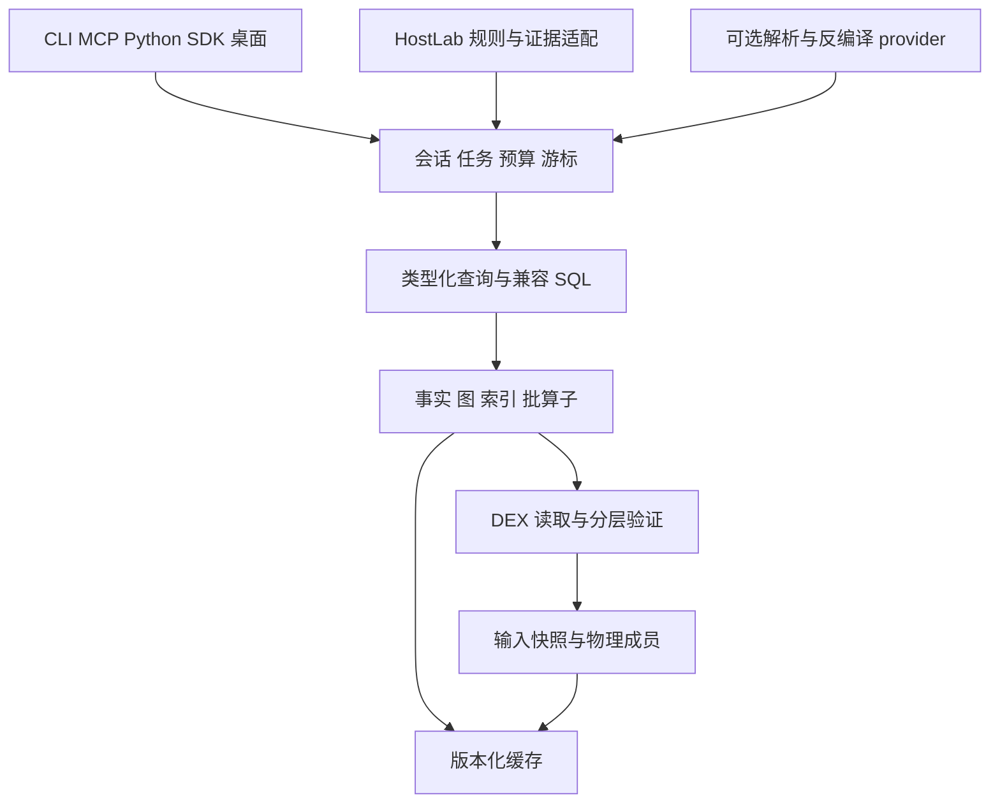

# MeguvizDexDash 完整工程实施计划

规格版本：0.1-draft。日期：2026 年 10 月 26 日。此文为待实施工程规格；历史证据与新代码状态分别记录。

## 1 项目使命与可交付结果

MeguvizDexDash 提供面向桌面、命令行、自动化与云端 worker 的通用 DEX 静态分析能力。它以自身受校验输入和事实核心承接 HostLab 当前依赖 DexSQL 的工作，支持独立 SDK、CLI、MCP 和后续桌面工作台。业务规则、远端调度和运行期 Hook 保持在对应项目中。

首个业务验收项目是 `jichuo1/innocent-lab-host-analysis`。BIL 只提供实际分析需求和验证工作负载；本引擎不能依赖 BIL 包名、FEATURE 或业务目录才能构建、查询与测试。

本计划定义三个产品层次：

| 层次 | 达成条件 | 可对外声称的范围 |
| --- | --- | --- |
| 纵向原型 | 真实输入 → 受校验快照 → 基础事实 → 查询 → 完整结果；基础平台可构建 | 已实现这条纵向能力，不能称替代 DexSQL |
| HostLab 可切换后端 | 所有 HostLab 必需关系／查询／指纹／门禁／报告等价，通过完整审计，独立 backend 可显式启用与回滚 | 已覆盖明确版本的 HostLab 工作负载 |
| 完整桌面分析产品 | 承诺的公开关系、资源、Smali、会话、缓存、SDK/CLI/MCP、桌面功能与平台矩阵逐项验收 | 按能力清单声明兼容与扩展，不使用无范围的“全部兼容” |

第一阶段重点是第二层，不先投入大型 GUI，也不把少量类查询 demo 当作完成。完整产品阶段继续补齐此前记录的 56 个公开关系及原生 MCP 12 工具对应能力；实际兼容列、函数、错误和生命周期仍须逐项验证，数量相同不等于语义相同。

## 2 固定边界

### 2.1 与 DexMeguviz 的分工

DexMeguviz 是独立的 DexKit 替换项目，主要运行约束与本项目不同。本工程可共享解析概念、输入身份、版本化事实模型和稳定 ABI，但默认开发、构建和发布均独立。

可复用实现必须进入独立版本包或可选 provider，记录源码来源、版本、支持格式和正确性资格。禁止两个仓库复制后各自修改同一解析器却仍宣称共用核心。未发现可用共享实现时直接推进本项目自有 reader，不等待另一个项目。

### 2.2 非首版必要项

ART/JIT 执行、Android 进程内 Hook、通用反混淆／受保护代码恢复、运行期反射目标的完全求解、OAT/VDEX/CDex 全版本、跨网络公开多租户服务均不是 HostLab 首版的前置条件。对静态不可见代码明确报告覆盖范围；外部取得的合法 DEX 可作为新来源导入。

JADX 只作为可选 Java 反编译 provider。精确代码事实和原始字节指纹不依赖反编译输出。首版默认本地 worker 与 stdio MCP，不新增必需云服务或上传 APK 行为。

## 3 证据与设计的优先次序

1. 用户明确目标和当前工作区的有效约束。
2. 本包的接口 schema、错误与完整性不变量，以及通过验收后更新的 ADR。
3. 当前实际 checkout 的代码与运行结果；每次注明提交和二进制身份。
4. 冻结的原始证据、规范和行为观察。
5. 性能假设与未来扩展建议。

当新证据与设计冲突，建立最小复现、更新 ADR 与所有受影响消费者，不能修改“完整”“引用”“命中”定义掩盖不等价。本包中历史数据不因新基线出现而被覆盖。

关键来源、适用范围和废弃的旧假设见 [证据基线](docs/00_EVIDENCE_BASELINE.md)。56 关系、两版黑箱观察、历史阶段与本轮性能数据均以 [证据索引](evidence/index.json)中的 SHA256 定位。

## 4 默认架构与依赖方向

默认 Rust stable，统一 workspace；稳定版本、MSRV、编译参数和依赖锁在 M0 实际构建后固定。跨语言接口使用版本化 C ABI 或隔离 worker，Python 初期优先消费 worker 协议，避免一次迁移所有宿主对象。



核心依赖方向是输入／类型 → DEX → 事实 → 查询 → 会话 → 对外接口。HostLab、桌面 UI、GitHub API、网络下载不反向进入核心。构建时通过 crate 依赖图和无业务字符串的公共用例验证此边界；不依赖简单的字符串禁用规则代替代码审查。

模块细节见 [核心架构与契约](docs/02_ARCHITECTURE_AND_CONTRACTS.md)。工程计划中的 crate、命令与 API 均待实现；文档示例不能当作现有可执行能力。

### 4.1 SQL 路线

生产高频路径使用类型化 IR 与专用算子。兼容入口首轮默认评估固定版本 SQLite 的只读 virtual-table 桥，把受校验事实映射为表，使用合法约束做候选筛选，而非先全量导入数据库。SQLite 的虚表和约束接口提供工程可行性，但不证明其语义等价 DexSQL，必须由冻结 corpus 验证。[SQLite 官方虚表接口](https://www.sqlite.org/vtab.html)

ADR-002 具有明确退出条件：HostLab 必需 SQL 的 NULL、数值转换、LIKE/ESCAPE、排序、聚合、JOIN/CTE、泛型/字符串处理等必须有符合声明 profile 的结果；无法实现的必需能力阻止 HostLab-MVP 资格，不能靠全程 fallback 宣称完成。可更换兼容执行器，但不扩大为先重写完整 SQL 数据库。

对虚表的 `omit`、`orderByConsumed`、LIMIT/OFFSET 下推，先保持保守行为，仅在精确等价证明后启用。声明已处理排序或过滤但实际仅返回近似候选，会造成静默错误。

### 4.2 机器接口路线

先完成结构化 JSON 批与完整状态，再比较可选列批表示。外部 MCP 始终保持合法 JSON 协议；二进制批由 SDK 或专用本地 worker 通道传输，不混入 MCP stdout。

结果 schema、能力协商和错误代码见 [契约索引](contracts/README.md)。所有新格式从第一版带版本、来源、长度、预算和完成语义；不要先依赖私有 Rust 内存布局，之后再补稳定 ABI。

### 4.3 输入与缓存路线

首版优先独立拥有、校验过的输入字节或私有内容对象，确保查询与解码取同一份字节。原始来源改写、替换、重命名和消失分别测试。mmap 仅在生命周期和不可变条件已保证时使用，外部文件的只读映射不构成不可变快照。

缓存键至少覆盖来源内容、逻辑输入多重性、事实 schema、解析／验证 profile、指令语义和必要 provider 身份。规则结果缓存另含规则与配置修订。物理去重不删除逻辑输入；负结果只在相关范围完整时缓存。缓存损坏、失配、过期和部分写入不能当作空数据。

## 5 工程目录建议

下面是未来实现目录，当前工程包未创建这些运行模块。crate 名称细化以架构文档为准；以职责边界优先，避免只为目录漂亮拆成过多空 crate。

| 未来路径 | 职责 |
| --- | --- |
| `crates/mdd-types` | ID、范围、状态、schema 和错误 |
| `crates/mdd-snapshot` | ZIP/DEX 输入、快照、内容身份 |
| `crates/mdd-dex` | 格式、字符串、元数据、代码读取与验证 |
| `crates/mdd-facts` | 事实层、调用点、引用、索引 |
| `crates/mdd-query` | 类型化 IR、执行预算与算子 |
| `crates/mdd-sqlite` | SQL profile 与虚表兼容桥 |
| `crates/mdd-session` | 会话、快照句柄、游标、取消 |
| `crates/mdd-cache` | 版本化持久事实与缓存验证 |
| `crates/mdd-wire` | 机器协议与可选列批编码 |
| `crates/mdd-worker` | 隔离进程与资源生命周期 |
| `crates/mdd-cli` | 人用 CLI 与机器输出入口 |
| `crates/mdd-mcp` | 原生 MCP 服务与能力映射 |
| `crates/mdd-ffi` | 稳定 C ABI 及所有权边界 |
| `python/` | 通用客户端、类型和错误映射 |
| `integrations/hostlab/` | HostLab provider、迁移与回归用例 |
| `apps/desktop/` | 后期桌面工作台 |
| `tests/fixtures/` 与 `conformance/` | 合成语料、独立 oracle、规范化结果 |
| `benchmarks/` 与 `artifacts/` | 真实 workload、逐轮测量与证据 |

若架构文档需要增加资源、Smali 或 provider crate，可调整此目录并记录 ADR；公开契约、任务依赖与验收要求不因目录调整而降低。

## 6 阶段实施与退出标准

完整任务及依赖在 [backlog.json](tasks/backlog.json)。下表规定阶段成果；任务 ID 是可执行管理标识，不代表已经完成。

| 阶段 | 任务 | 主要输入 | 交付与退出标准 |
| --- | --- | --- | --- |
| M0 证据与决策 | MDD-001～006 | 当前 workspace、固定 HostLab、两版 DexSQL、原始证据 | 工具链锁定；实际 query/workload/profile 清单；A0/A1/A2 方案；fixtures 与 oracle；ADR；阻塞项精确记录 |
| M1 骨架与快照 | MDD-010～014 | M0 契约与语料 | 可构建 workspace、版本/能力入口、受校验输入快照、完整成员身份、基础版本/边界检查、worker 生命周期；明确只是原型 |
| M2 完整事实 | MDD-020～026 | M1 输入与 corpus | 字符串/类型/原型、定义/注解/泛型、指令/payload/异常、引用/call site、原始指纹、必要索引；独立比较过关 |
| M3 查询语义 | MDD-030～035 | M2 事实、HostLab SQL corpus | typed IR、兼容 SQL 桥、必要表/算子、正确筛选/排序、分页快照、预算/取消与返回状态；必需查询无静默缺口 |
| M4 运行接口 | MDD-040～044 | M3 完整查询能力 | JSON 批、可选列批对照、SDK/C ABI、真实 CLI/MCP worker；真实 producer→consumer 完整消费证据 |
| M5 HostLab 替代 | MDD-050～055 | M2–M4、固定业务规则 | 独立 backend 安装/选择、NativeSession、surface、batch/远端适配、全量 shadow、逐项等价和可回滚启用；此后才称 HostLab 可切换后端 |
| M6 性能与复用 | MDD-060～065 | 完整等价后的 profile | 用实测热点优化算子和传输、共享门禁事实、持久缓存和调度；最佳现成对照；第二个通用消费者 |
| M7 产品完整性 | MDD-070～075 | 已稳固核心和 capability ledger | 更多公开关系、Smali、资源、桌面与可选格式/provider、高层分析；按实际资格声明功能 |
| M8 发布资格 | MDD-080～083 | 完整代码与证据 | 平台/ABI、故障与恢复、性能资格、构建与发行清单、版本化配置、灰度与回滚手册 |

### 6.1 M0 的具体行动

首先冻结输入身份、源码与二进制摘要，不直接把最新版本覆盖基线。提取静态 SQL 模板并记录动态参数类别；必要时对被授权语料执行请求录制，确保每条必需语句都有完整结果、字段/类型、重复性、排序和异常状态。工具列表分清 DexSQL 原生 MCP、旧 HostLab dexq 和 remote orchestration 三层。

行为记录保存请求、响应、二进制和输入摘要及断言，成功观察不冒充全面证明。对尚未测的 MUTF-8、TEMP/游标、取消作用域等补最小差分用例。

M0 可以在没有私有 BIL APK 时完成骨架决策和公开/合成测试，但完整 HostLab 基线必须标为受阻。任何私有 APK 缺失都不能用小公开样本替代后声称同一 workload 已测。

M0 不允许无限期“继续调研”。针对每个未解问题写退出条件、可执行实验和默认保守实现，解决实际影响当前阶段的问题后推进 M1。

### 6.2 M1 与 M2 的纵向顺序

最小纵向首先支持一个合法标准 DEX 的真实 header/string/type/proto/method/class 读取和查询，再扩展 APK、多 DEX、代码事实和边界语料。每次新增事实层把完整性、限制与支持版本写入 capability ledger。

禁止用一套动态脚本调用 DexSQL 再把结果包装成“自研 parser”。临时对照 provider 必须带真实来源身份，并明确不满足自有核心退出标准。首个自有事实层应能在没有 DexSQL 二进制时通过独立 fixture 验证。

支持矩阵按确切版本枚举；036、041 与特殊容器不能靠一个大于等于比较自动接纳。MUTF-8、索引范围、LEB128、指令边界、code units、共享区间、异常表的错误分类与完整性一起实现。

### 6.3 M3 与 M4 的接口顺序

先使一条真实 HostLab 查询经过 typed facts 与完整返回协议运行，然后增加冻结 corpus。SQLite 桥不应把业务查询硬编码成特殊答案；可将通过语义验证的谓词转成 typed IR 或索引访问。

同一个快照上的结果、Smali、资源和证据应有一致来源。页响应的成功不代表全部查询已完成。保留 session/catalog 代次、总行数是否精确、截断和续页状态。预算耗尽不是普通 EOF。

原生 MCP 资源工具可在 M7 扩展，但 M4 不应注册返回伪成功的空实现。HostLab 实际调用 decode/get_manifest 的必要子集须在 M5 前完成；未承诺的其他资源工具继续 unavailable。能力明确不可用或不注册；只有支持清单里的能力进入资格验收。

### 6.4 M5 必须用完整业务证据退出

保留 HostLab 的规则与最终报告，先更换数据 provider。新增 backend、安装与版本摘要，拆清 engine implementation、SQL dialect 和 profile。旧 `--backend dexsql` 不悄悄绑定新程序。

shadow 阶段在独立目录写报告和缓存，以相同输入/规则/预算对照，避免共享输出文件或完成缓存污染结果。逐项核查现有 27 FEATURE、结构/门禁状态、原始代码/资源指纹、调用点与次数、泛型、协议、类记录、跨版本变化及最终 verdict。

如果某条必需查询不受支持，需要修复或继续未完成状态。可以为用户保留显式旧后端，但不能靠 fallback 使测试看似通过后给新后端签发资格。回退原因、实际引擎身份和覆盖状态必须写入证据。

### 6.5 M6 只优化真实热点

优先验证机器输出膨胀、schema 重复探测、逐行对象、surface 聚合和门禁重复事实。每次优化保留基线与正确性结果，记录贡献发生在哪个时间窗。批传输、索引、并行和缓存的收益不能重复计数。

永久缓存先按完整物理内容对象和事实 schema 复用，再研究细粒度依赖。041 共享数据及全局/负依赖使按逻辑 DEX 或按变化字节比例复用存在风险。增量必须有可审计依赖和失效规则。

采用 profile 证明内存瓶颈后，再考虑 mmap、内存池、SIMD 或线程细分。新增优化必须提供可以关闭的路径，保持标量/保守参考实现用于差分。多层线程池共享总并行预算，不将 worker、DEX 与查询各自开满线程。

### 6.6 M7 与 M8 的产品完成标准

桌面工作台复用同一 SDK/worker，提供输入与来源检查、查询、xref、Smali、差异、取消和导出；不能在 UI 另建解析核心。默认界面可在 ADR 后采用 Rust 后端配轻量 WebView，具体框架以可支持的平台和打包实测决定。

公共关系和资源工具依 compatibility ledger 逐项验收；高级 CFG、常量传播、候选指纹把“已编码事实”“推断”“未知动态目标”分开。反射、动态加载或 invoke-custom 的未知实际目标不可被当作确定调用边。

首版发布资格覆盖 Linux/Windows x86_64。仅交叉编译通过不等于平台运行通过；macOS arm64 与其他架构应在对应运行环境完成数据、生命周期和性能对照后再 advertise。

M8 的发布动作遵循执行会话已有授权。无发布授权时完成可审查包、变更、验收与回滚材料，不把整个工程提前停在“是否继续”的问题上。

## 7 性能预算与分母

历史 A0 原始记录有两个不同 APK，每个当前实现只有一轮。当前完整 worker 为 94.630143/85.572220 秒；S 为 13.663421/11.911596 秒；F 为 56.525247/50.801524 秒。P 和其他余量一起分别为 24.441474/22.859099 秒。

对于同工作量、其他部分不变的两个完整阶段目标：

```math
E_{new}=P+R+O+\frac{S}{s_S}+\frac{F}{s_F}
```

| 条件预算 | 9.17.0 | 9.16.1 | 说明 |
| --- | ---: | ---: | --- |
| S/F 各 1.5× | 71.234 s | 64.668 s | 降时约 24% |
| S/F 各 2× | 59.536 s | 54.216 s | 主目标，降时约 37% |
| S 2×且 F 3× | 50.115 s | 45.749 s | 挑战目标，降时约 47% |

这是已有阶段成本导出的验收预算，实际 B 仍未实现。执行者必须在当前同一环境核验 A0/A1/A2，并对实际可部署且完整兼容的方案测量，再用实际阶段重算；A2 若经验证不可用或没有合理优化空间，记录尝试、证据和不纳入原因，不为凑组制造一个实现。不得把另一台机器的 60/55 秒作为无条件门槛，也不得把 core 单项 2×替代 S/F 复合阶段 2×。

五组定义、统计及资源口径见 [验证文档](docs/04_VALIDATION_AND_PERFORMANCE.md)。所有性能结果记录 workload/input/engine/source/config/cache/thread/machine 身份。没有完整结果等价的运行不能作为有效速度样本。失败、超时、缺样本、未运行均单列，不能剔除后宣称通过。

性能替代资格的建议项目策略：关键完整审计和 bulk 相对最佳可用现成路径有至少 10% 的配对中位降时，其他必需负载无超过 5% 的可复现退化；稳定性按同环境多轮确认，阈值允许在 M0 校准并通过 ADR 解释调整。约 37%/47% 仍作为对原 A0 的阶段目标，不因收益来自上游而登记为自研独有贡献。

功能预览由 MDD-055（HostLab）与 MDD-073（桌面）输出，明确标识未获性能替代资格；MDD-083 仅在 MDD-082 通过后签发正式性能发行。门禁事实复用 MDD-062 是按发行范围选择的能力：若未采用，保留独立原门禁且完整计入 E；若启用或宣称该优化，则必须取得对应资格。不得为解锁发布伪造完成状态。

资源指标独立报告：CPU user/system、峰值内存的真实来源和采样误差、实际读写/传输字节、输出大小、页数、缓存命中、排队与取消耗时。仅编码体积减少不能称为整体 RSS 同比例减少。

## 8 正确性与完整性资格

完整审计至少同时满足：请求成功、所需输入完整、所需事实层完整、执行完整、无截断、无剩余页面、无残留 cursor，且全部规定证据匹配。coverage 限定作用范围，不要求无关可选事实全部建立；也不能把要求的事实从 scope 中删掉来通过。

独立验证对来源、字段/类型、NULL、重复次数、排序要求、方法原始字节、资源原字节及跨版本结果建立规范化协议。两端都采用相同有缺陷代码时 hash 相等不证明正确，因此加入独立实现、手工小 fixture 与变形测试。大型生产结果等价与格式错误语料分别验证。

所有权和并发测试包含：源改写、旧 handle、目录代次变化、取消、预算、IPC 中断、worker crash、部分 cache、关闭顺序、同内容多次输入。无效或不完整输入不得被转成“没有命中”的正常结果。

建议 CI 分层：快速单元/契约/小语料用于每次变更；完整差分与平台集成用于合并门槛；大型 BIL 和性能在隔离且固定资源环境执行；模糊测试和故障长测独立运行。未具备数据或 runner 的 gate 显式 blocked，不默认 skip 后算资格通过。

## 9 执行治理与持续交接

`tasks/backlog.json` 是任务依赖入口，`STATE.md` 是当前状态，ADR 是决策依据，compatibility ledger 是对外支持清单，artifact index 是证据索引。不要依赖聊天记忆进行跨轮恢复。

主代理对接口和最终集成负责。分工建议：格式/事实、查询/协议、HostLab 迁移、独立验证；共享文件单写入负责人，独立任务并行，依赖与集成顺序执行，CPU 基准独占时段。

每项任务完成须具备代码、定义的输出、实际验证与证据；只更新文档不算实现，单元测试通过不自动等于完整审计或性能通过。受阻任务记录缺失输入、如何恢复和可继续的独立工作。

重要经验使用 [经验模板](templates/EXPERIENCE_RECORD.template.md)，记录现象、证据、根因、最终方案、失败方案和验证范围。原始观测只追加，修正结论使用新的说明与引用，不覆盖旧记录。

## 10 最终交付清单

- 可复现构建的源码、锁文件、平台产物和版本身份。
- 可独立使用的 CLI、worker、Python 客户端；声明支持的 C ABI/SDK。
- 版本化数据、输入快照、错误、分页、取消和能力契约。
- 实际支持矩阵、所有已承诺关系／工具／SQL profile 的资格清单。
- HostLab 集成变更、显式 backend 选择、shadow 结果和回滚说明。
- 原始输入／语料获取方法、独立验证器、规范化结果与完整性证据。
- A0/A1/A2/B0/B1 的同条件原始性能、统计、资源与剩余差距。
- 内容与缓存迁移策略、失败恢复、已知局限与发布说明。
- 能从任意阶段恢复工作的 STATE、ADR、任务图和经验记录。

完成标准是这些内容实际存在且通过对应 gate，而不是文档中列过这些标题。该标准应从 M0 开始持续维护，避免最后集中补写不可复现的“完成报告”。
