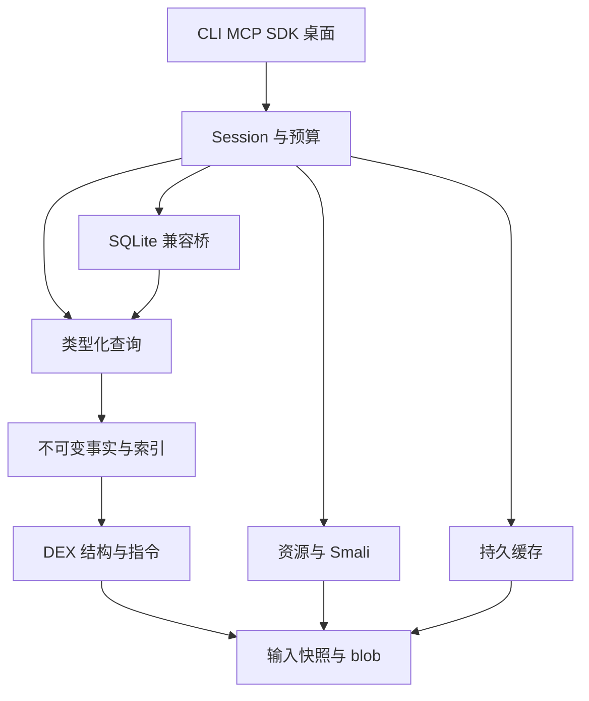

# MeguvizDexDash 核心架构与接口契约

规格版本：`0.1-draft`。日期：2026-10-26。状态：**拟定契约，待实现、待差分验证；本文件不是已有引擎的 API 文档。**

本文件确定桌面与云端核心的边界、身份、所有权、查询语义、返回状态与存储格式。任务阶段以 [ENGINEERING_PLAN.md](../ENGINEERING_PLAN.md) 为准；HostLab 外部入口、SQL corpus 与 12 个 MCP 工具的映射见 [03_HOSTLAB_MIGRATION.md](03_HOSTLAB_MIGRATION.md)；验证及发布门禁见 [04_VALIDATION_AND_PERFORMANCE.md](04_VALIDATION_AND_PERFORMANCE.md)。JSON Schema 由 [contracts](../contracts/README.md) 管理。本文件中的 `必须` 约束新实现，不代表 DexSQL 内部采用同一种实现。

## 1. 目标、证据与架构决定

MeguvizDexDash 提供可复用的 DEX / APK 静态事实、查询与证据读取服务，第一接入方是 HostLab。它应能被 CLI、MCP、Python、其他语言 SDK 和桌面界面消费；核心中不得出现 BIL 包名前缀、FEATURE、family、protocol、GitHub Actions 分组或业务版本选择。

本项目不替代 Android 进程内 DexKit，也不将另外的 DexMeguviz 项目当作已经交付的解析库。新核心默认独立构建；未来可通过版本化 provider 协议共享能力。

### 1.1 已知事实只用于约束设计

| 已确认的事实 | 本文件据此作出的设计决定 |
| --- | --- |
| 固定 HostLab main 为 `8782f43d537c442905123e35af325c412caa5188`，安装器固定 DexSQL 0.1.0。[H1] | 新 backend 身份为 `meguvizdexdash`；不替换固定哈希文件，不伪装成 DexSQL。 |
| 当前 HostLab 已实现驻留会话、64 KiB 块读取、背压、方法范围预筛、输入 SHA 与物理 DEX inventory 验证。[H2][H3][H4] | 继续保留这些基线；核心新增原生契约，不能把已有能力登记为新收益。 |
| 两版定向实验中，驻留 SQL 可读旧事实，而修改源文件后的 decode 拒绝；TEMP 改动可影响后续 offset 页。[E1][E2] | 原生模式统一不可变字节快照与目录代次；兼容模式单独声明生命周期和分页语义。 |
| 重复路径、同内容不同路径与同 descriptor 定义在已测输入中保留逻辑多重性。[E1][E2] | 允许底层字节去重，禁止因此丢掉来源出现次数、定义或引用站点。 |
| 上游 0.1.1 已改善实测大表输出；新列批结果只有消费端原型证据。[E3] | 独立比较 A0、A1、A2、B0、B1；不预先宣称重写 parser、二进制格式或某种语言一定更快。 |
| DexSQL 公开发布仓库未包含核心实现。 | 本设计是独立实现方案；不声称恢复其优化器、索引、缓存哈希或映射算法。 |

历史蓝图曾讨论 C++20。此次工程包明确选择 **Rust stable 核心 + 稳定 C ABI + 独立 worker**；这是当前的工程决定。工具链、SQLite 和其他依赖的精确版本在 M0 验证并锁定，不使用未验证的“最新版”作为兼容保证。

### 1.2 两条查询入口、一份事实与生命周期

- **生产快速路径：类型化查询 IR 与算子。** 输入是版本化请求、实体 ID、过滤条件和投影，不通过拼接 SQL 来调用内部核心。
- **首轮 SQL 路径：固定版本 SQLite 的只读 virtual-table 兼容桥。** 只将事实按需暴露为关系，不默认把整个 APK 的事实全量 ETL 到另一个 SQLite 数据库。
- Session 负责目录、预算和查询生命期。SQL 与类型化路径共享事实、文本语义、取消 token、来源和完成状态。
- 通用 SQL 执行器自研推迟到证据说明必要时。M0 / ADR-002 必须先判定 SQLite 桥能否正确覆盖真实 HostLab corpus；更换兼容执行器不能倒逼核心实体或快照改变。

第一纵向原型可以只贯通输入到一个小查询，但 **HL-MVP 是 M5 的完整 HostLab 必需工作流等价**。只返回类数量、缺引用或依赖整程 fallback 的实现不得标记 HL-MVP 完成。完整已承诺的 12 工具公开面、更多关系与资源能力到 M7 才具备发布前提。

## 2. Workspace、模块边界与依赖方向

包名使用 `mdd-*`，Rust import 使用 `mdd_*`。下面是建议拆分的责任边界；实现者可以在同一 crate 内先设模块，但不得借此制造反向依赖或把业务规则放入核心。

| 模块 / crate | 唯一主要职责 | 可依赖的项目层 |
| --- | --- | --- |
| `mdd-types` | ID、范围、结果状态、错误、能力名、基础值类型 | 无其他业务 crate |
| `mdd-contracts` | 请求 / 响应结构、schema 版本与校验 | types |
| `mdd-platform` | 文件句柄、私有临时对象、映射、计时、进程与平台限制接口 | types |
| `mdd-storage` | 内容 blob 读取与持有的 trait、摘要与原子发布接口 | types |
| `mdd-snapshot` | 输入清单、ZIP 成员、不可变 blob、物理 / 逻辑来源 | storage、platform、types |
| `mdd-dex` | 受界限检查的 DEX 结构读取、指令与元数据解码 | storage、types；只接收已持有的范围，不自行重开来源路径 |
| `mdd-resources` | AXML、资源表、资源 XML 与原始 APK 成员读取 | snapshot、storage、types |
| `mdd-facts` | 定义、引用、注解、调用点等事实模型和分层建立 | dex、snapshot、types |
| `mdd-smali` | 已验证事实的 Smali / context 展示和文本来源映射 | dex、facts、semantics；不另造 DEX parser |
| `mdd-index` | 稠密 / 稀疏索引、字符串键与 postings 的构建和查询 | facts、types |
| `mdd-semantics` | DexText、比较、LIKE、CAST 等版本化语义 | types |
| `mdd-query` | 类型化 IR、算子、投影、过滤、连接与聚合、执行统计 | facts、index、semantics、contracts |
| `mdd-sqlite` | SQL 前端、只读虚拟表、方言适配与计划诊断 | query、facts、semantics、contracts；不拥有源文件 |
| `mdd-cache` | 版本化索引文件、manifest、section 校验与重开 | storage、facts 的序列化 schema、types |
| `mdd-session` | snapshot/session/catalog/query 注册、调度、配额与取消 | snapshot、facts、query、sqlite、cache、resources |
| `mdd-provider-api` | 可选外部 provider 的能力与只读事实 / blob 协议 | types、contracts、storage trait |
| `mdd-ffi` | C ABI，受控所有权与错误转换 | session、contracts |
| `mdd-wire` | 专用协议 framing、JSON / 列批编码与结构验证 | contracts、types；不依赖 session 或业务规则 |
| `mdd-worker` | 专用机器协议、进程隔离、流控和故障归属 | session、wire、contracts |
| `mdd-cli`、`mdd-mcp` | 用户命令或 MCP 的协议适配；不另造解析器 | contracts、worker client 或 session |
| Python SDK / HostLab adapter | 批量消费、HostLab 规则与现有报告的适配 | 公共 SDK；不得读取 Rust 私有布局 |

`mdd-cache` 不能反向要求 parser 从缓存模块读取文件。`mdd-session` 在上层组合 snapshot 与 cache，底层通过 `BlobReader` / `BlobLease` trait 共享内容。provider 注册也由上层完成，核心不依赖某个具体 provider。



依赖图的关键约束是：**入口不能绕过快照读取源路径，业务层不能绕过公共接口读取内部指针，SQL 桥不能成为事实存储的唯一主人。**

## 3. 实体、身份与损失零容忍的数据模型

### 3.1 同内容不等于同一来源，同 descriptor 不等于同一定义

| 名称 | 拟定含义 | 禁止的替代方案 |
| --- | --- | --- |
| `ContentId` | 完整不可变物理 blob 的 SHA-256；编码约定 `sha256:` 加 64 个小写 hex | 只用路径、mtime、ZIP CRC 或 DEX header checksum |
| `SourceOccurrenceId` | 输入列表中的一次出现，含 input ordinal、archive member ordinal、选择策略与父来源 | 将相同内容、同路径或 symlink 自动合并成一次逻辑输入 |
| `PhysicalDexId` | 物理 blob 中一个被识别的 DEX 容器 / 文件身份 | 将物理 ZIP 成员直接等同于一个逻辑 DEX |
| `DexOccurrenceId` | 一次来源中的一个逻辑 DEX，包含逻辑 header offset 和版本 | 只按 entry_name 或 descriptor 标识 |
| `StringPoolId` | 实际字符串池的物理身份和来源映射 | 假定每个 file_id 天然是独立字符串池 |
| `EntityRef` | `snapshot_id + dex_occurrence_id + entity_kind + local_index` | 跨 DEX 单独使用 method_idx / type_idx |
| `ClassDefId` | 以 `class_def_idx` 定位的类定义；另有其 `type_idx` | 混用 `class_idx` / type index 与定义数组位置 |
| `MethodRefId` / `MethodDefId` | method_ids 中引用，与 class_data 中具体定义分开 | 把所有 method_ids 当作本 APK 中有方法体的定义 |
| `ReferenceSiteId` | 方法定义、指令 code-unit offset、操作数种类与序号 | 只保留去重后的调用边，再用边数冒充调用点数量 |
| `SemanticKey` | descriptor、name、proto 等供查询和跨版本匹配的键 | 假定语义键全局唯一，或者是跨版本稳定物理 ID |

`snapshot_id`、`session_id`、`query_id` 是不可猜测的运行期不透明字符串，不能持久化后当作下一进程的有效 handle。缓存另有可重复计算的 `snapshot_content_key`：它绑定完整有序 occurrence 清单、ContentId、格式及选择策略。相同 bytes 可以共用 buffer 和底层索引，但每个 occurrence 仍展开为自己的逻辑事实。

兼容层的 `file_id`、`string_pool_id` 是该数据集内的映射，必须通过版本 fixture 决定分配与重复输入语义；不能把目前观察到的输入顺序推广为所有版本、容器与错误路径的保证。

所有 offset 明确单位：`byte_offset`、`code_unit_offset`、`instruction_ordinal` 不可混用。长度运算使用 checked arithmetic，先验证范围，再建立 slice。DEX code 的 `insns_size` 单位为 16 位 code unit，不是指令条数。[A1] 兼容 Smali / Manifest 的文本续页按其展示 UTF-8 byte offset，不能与原始 DEX byte offset、行号或 context 索引互换；精确外部参数见 03。

### 3.2 原始字符串不强制变成 Rust String

AOSP 定义 DEX 字符串采用 MUTF-8，补充平面字符以 UTF-16 surrogate pair 编码，NUL 有专门编码；一般 string_data 可以包含孤立或失序代理项，名称字段另有更严格规则。[A1]

内部 `DexText` 至少保留：

- 原始 MUTF-8 字节范围，不包含终止字节；绑定 `BlobLease`。
- 解析后的 UTF-16 code-unit 序列或可复用迭代器，以及 header 声明长度的校验状态。
- 严格标量 UTF-8 转换结果 `Result`；有孤立代理项时不能偷偷生成有损身份键。
- 可选 `display_utf8` 和 `lossy_display`，只供展示，不进入原始指纹、实体比较或完整性摘要。

NULL、空字符串、空 BLOB、含 NUL 的字符串分别编码。任何 C ABI 字符串都携带长度；JSON 必须是合法 Unicode，不能将非法 UTF-8 直接写入 JSON。原生无损输出使用显式 `dex_mutf8` / `bytes` 列，JSON 中使用有标签的 base64 字节；展示列需要另名，禁止以展示替代原值。

原生文本语义定义为 `mdd-text-v1`：身份与 raw cast 使用原始字节；DEX 文本的确定性顺序使用 UTF-16 code units；不自动做 Unicode normalization、locale collation 或大小写折叠。调用者需要 Unicode 展示搜索时必须选择对应操作，并承担其不同语义。

DexSQL 0.1.1 内嵌说明和既有小样本涉及特殊 LIKE、CAST、长度与替换行为。它们属于**版本化兼容测试项目**，不能直接以 SQLite 默认 TEXT、BINARY collation、`length()` 或 `LIKE` 替代；也不能把 0.1.1 的全部说明自动写成 0.1.0 已验证事实。具体门禁见第 6 节。

### 3.3 跨 DEX 解析保持歧义与多重性

定义检索返回 `none | one | many`，不按哈希表最后写入者决定结果。调用点首先记录 DEX 编码的引用目标；动态分派、反射和运行期生成代码的推断放入独立分析层，并携带依据、适用范围和未知项。

解析到一个外部方法引用不意味着找到其方法定义；引用关系 complete 也不等于完整运行期调用图。跨版本匹配返回候选与匹配依据，不能将旧版本 EntityRef 直接用于新 snapshot。

## 4. 输入快照、映射与生命周期

### 4.1 默认输入过程

1. 记录显式输入顺序和选择策略。APK 的中央目录先完整枚举，重复成员名、异常目录和选择歧义进入 inventory；不依赖最后一次同名 lookup。
2. 将来源捕获为私有内容对象，并在读取时计算强摘要；若用户或 HostLab 提供 expected SHA，只有匹配才能接纳。文件权限只读、`dup(fd)` 或只读 mmap 均不能使其他持有写权限的进程失去修改能力。
3. 校验 ZIP 层与所选成员；STORE 成员可在私有不可变归档内映射子范围。压缩成员按预算解压到私有 blob，再计算内容身份并检查大小 / CRC。
4. 识别全部请求范围内的物理 DEX 和逻辑 DEX，建立成员账本；名称像 DEX 但无合法 magic 的条目不得悄悄当作不存在。
5. 原子发布 snapshot manifest。未完成验证的 blob 不得作为完整 snapshot 命中缓存。

初版可使用复制 + 私有文件映射。reflink、共享内存或外部不可变对象的导入只有在平台和所有权契约验证后才能减少复制。不得因为希望达到“零拷贝”而读取可变外部地址。ZIP member name 是归档内身份，不能直接当作宿主写入路径；读取 / 导出成员须有独立的路径和重复名称政策。

若没有 expected SHA，快照只能证明“本次捕获的字节及其摘要”，不能证明它等于路径在更早时间的内容。前后 stat 不能代替字节身份；完整验证结果必须绑定捕获内容，HostLab 现有前后 SHA 验真继续保留。[H3]

### 4.2 覆盖范围显式声明

`InputScope` 包括输入集合、成员选择策略、允许格式、需要的事实层。HostLab profile 初始复用实际 inventory 规则，包括顶层 `classes\d*\.dex` 成员和现有歧义拒绝条件；通用原生模式允许显式选择其他路径或原始 DEX。[H3]

必须区分“目录已枚举”“所选 DEX 全部解析”“所有可能隐藏或运行期生成代码可见”。`coverage.input=complete` 只声明所请求、可审计范围的完成，不能由静态 APK 解析推出隐藏代码已恢复。

非连续的 classes 编号、额外目录和重复名字按 profile 处理并记录；接受某个输入是分析器的行为，不是声明 Android 安装器接受这种 APK。

### 4.3 DEX 041 与后续格式

模型从第一天区分 physical container 与 logical DEX。初始发布能力显式枚举 035、037、038、039、040；036 不因为数字连续而标记支持。041 需要对共享物理容器、逻辑 header 与偏移规则单独验证后才能启用。[A1]

041 未获准时返回 `UNSUPPORTED_CAPABILITY`，不把其中首个逻辑 DEX 当作完整输入。CDex / VDEX / OAT 各自有能力项；发现 magic 不能等同于已经完成可靠解析。

### 4.4 对象所有权

| 对象 | 持有者与寿命 | close / release 的结果 |
| --- | --- | --- |
| `SnapshotHandle` | 持有 manifest 与内容 blob；可被多个 session 引用 | close 后不接纳新 session；已有 session 的 lease 继续有效，直至其关闭 |
| `SessionHandle` | 固定 snapshot、profile、sql_dialect、TEMP catalog 与配额 | close 阻止新查询，取消本 session 未完成查询并关闭 cursor；不影响其他 session |
| `PreparedQuery` | 绑定 session、参数类型和不可变 catalog generation | 不偷偷使用后来目录；重新 prepare 得到新 epoch |
| `QueryHandle` | 持有 snapshot/catalog leases、计划、预算和取消状态 | 计算完成仍可由 cursor 消费已物化结果；该结果流发出最终 End 后不再追加 batch；需 release 释放对象 |
| `BatchHandle` | 独立 owned lease；指向列 buffer 或固定 blob 片段 | 即使 query/session 已关闭，已发 batch 在最后一次 release 前仍有效 |
| `ProviderLease` | 保证外部 provider 的 buffer、实例和代码仍可访问 | 有借用数据时不得卸载 provider 或回收 buffer |

close 是运行期语义，release 是内存所有权。对有效 handle 的重复 close 可以幂等；C ABI 对同一引用重复 release 是调用者错误，不能许诺凭空恢复已释放指针。进程协议可以安全拒绝过期 handle，因为它使用经过校验的 handle 表而不是任意裸地址。

快照接纳后，原生 SQL、Smali、资源和 raw bytes 都读同一组私有 blob；删除或修改原路径不会改变该快照。确需外部来源变化检测的兼容模式通过单独 provenance guard 执行，不能让 SQL 与 decode 悄悄读两个版本。与 DexSQL 的这些生命周期差异必须列入兼容 ledger，不能只凭同名 profile 宣称逐行为完全复刻。

## 5. 事实建立、验证层与类型化查询

### 5.1 分层建立而非全量抢先物化

| 层 | 必需内容 | 建立策略与完整状态 |
| --- | --- | --- |
| `inventory` | 所选物理成员、逻辑 DEX、来源与摘要 | open 必需；目录与覆盖失败不能绕过 |
| `structure` | pools、types、protos、class definitions、fields、methods、interfaces | HL-MVP 必需；范围及关联索引全部验证 |
| `annotations` | directory、set、annotations、encoded values、Signature 顺序 | HL-MVP 泛型所需；保留原始层级、ordinal 和源偏移 |
| `code_layout` | code_item、registers、insns 范围、try/catch、payload 界限 | 提供 raw 方法体前必需，不把未知 body 当空 |
| `references` | 字符串、类型、字段、方法、数字等操作数与引用站点 | 按 method / DEX 建立，发布时附精确覆盖 |
| `smali` | 已验证指令及结构的展示 | 复用 code facts，不重开 APK；展示规范另有版本 |
| `resources` | 原始成员、AXML、资源表与配置 | 按请求建立；原始资源指纹与解析表示分开 |
| `derived_analysis` | CFG、def-use、调用目标近似解析等 | 可选，不是精确事实的默认前置依赖 |

资源字符串池使用资源格式自己的 UTF-8 / UTF-16 规则，不复用 DEX MUTF-8 解码器。[A3] Manifest 保留 namespace、typed attribute、缺省 / 显式值和原字节来源；解析属性与按 Android 版本推导的 exported 等语义分别建模，未完成资源解析的引用不能当成已解析字符串。

事实块从 `unbuilt → building → ready` 转换，失败记录其 scope 和 error。构建中的半成品不得发布为 ready。多个查询共用一次构建任务；取消其中一个等待者不应破坏其他查询的构建，最后一个持有者离开时才决定取消。

结构验证不等于 ART 全部运行期验证。分别记录已执行的范围 / 索引校验、指令边界检查和可选参考 verifier 结果；不得把校验 checksum 或解析成功写成 Android 可执行性证明。

### 5.2 指令与原始指纹必须保留的信息

基础 IR 必须显式区分普通 / range invoke、invoke-polymorphic 的 method 与 proto、invoke-custom 的 call site、method handles、switch / array payload、try / catch 和不可识别操作数。实际格式与指令表以固定 AOSP 版本为依据。[A2]

`method_calls` 类关系保存每个调用站点；对 `(caller, callee)` 分组之后的 count 必须与原始站点数相符。外部 / 未解析引用保留，不能因为找不到 class definition 就过滤掉。

HostLab 原始方法指纹要求方法名字和 proto 按既有规则组合、按既有排序访问，再加入原始 insns 字节；抽象 / native 无 body 与存在空 body 不混淆。该规则继续放在适配层，核心提供按准确方法范围读取的 raw bytes 与来源。不得用规范化 Smali、重排后的 IR 或去 payload 字节替代。[H4]

`dalvik.annotation.Signature` 等泛型信息按真实 annotation hierarchy 与 ordinal 重建。关联键包括 file/string_pool 身份；只拼接同名字符串或仅按 method_idx join 会产生跨 DEX 错误。[H5]

### 5.3 拟定 IR

IR 首版应包含 `Scan`、`SelectIds`、`Filter`、`Project`、`EquiJoin`、`Aggregate`、`Order`、`Limit` 与 `ReadCodeBytes`。所有节点携带输入 schema、逻辑值类型、所需事实层和语义版本。`Eq`、`Prefix`、`Like`、`RawBytesEq` 是不同谓词，不用一个字符串比较函数包揽。

优先支持的索引为 DEX 内整数 ID / 范围、descriptor / name / proto 精确键、引用目标 postings、方法定义到 code_item 的直接定位。位图、trigram、SIMD、细粒度 arena 和特殊压缩是后续 profile 驱动的实现选择，不能成为正确性依赖。

SQL 编译结果可以包含 SQLite 执行的组合算子，不要求第一版自己执行全部 SQL。类型化请求必须能直接命中同一 facts/index；公共 IR 不包含 HostLab 的 family / protocol 业务分类。

## 6. SQL 兼容桥与语义门禁

### 6.1 方言与能力不混为一谈

`profile` 表示工作流、完整性与兼容政策，例如 `hostlab-audit-v1`、`dexsql-0.1.0-compat-v1`、`dexsql-0.1.1-compat-v1`、`mdd-native-v1`。`sql_dialect` 独立指定 `dexsql-0.1.0-sql-v1`、`dexsql-0.1.1-sql-v1`、`mdd-sql-v1`，纯类型化请求使用 JSON `null`。以上名称均为拟定，未通过验收不得公告为 admitted。

SQL 只读是指业务事实不能被改写。允许的 TEMP / VIEW 定义保存在 session catalog，不是对 DEX 事实执行 UPDATE / INSERT。ATTACH、文件访问扩展、load_extension 和未承诺 PRAGMA 不属于原生公开能力。

### 6.2 虚拟表契约

SQLite 官方虚拟表接口通过 `xBestIndex` 与 cursor 回调协商访问；`omit` 和 `orderByConsumed` 填错会改变结果，而不只是影响速度。[S1]

初版具体要求：

1. `xBestIndex` 只描述可用索引及代价，不能在优化器试探调用中建立全部昂贵事实。
2. 只接受 `usable` 的约束；传参序号、比较类型、NULL、collation 与 IN 行为需要逐项测试。
3. `file_id + method_idx`、定义索引、原始精确字符串键可推送；大小写折叠 LIKE 只能当候选预筛时，必须保留上层精确过滤。
4. 无完整语义证明时 `omit=false`、`orderByConsumed=false`。LIMIT / OFFSET 不得越过会改变多重性或排序的 join / filter 随意下推。
5. rowid 在关系内唯一且稳定，不以 descriptor 作为 rowid。兼容列重复名字也不能被 dictionary 结构偷偷合并。
6. 只读 vtable 不提供 `xUpdate`；由 session 统一执行预算、取消与 snapshot lease。
7. explain 输出含实际访问路径、索引键、下推与残余谓词、事实层、估算行数和执行后实计数。它解释本实现，不声称揭示 DexSQL 的执行计划。

### 6.3 ADR-002 的阻断性验证

| 类别 | 必须验证的差异 | 失败时的处理 |
| --- | --- | --- |
| NULL 与动态值 | NULL / 空字符串 / 空 bytes、聚合、外连接、CAST、64 位数 | 必需 corpus 失败则桥不准入，不能返回看似合理的默认值 |
| LIKE 与 ESCAPE | 0.1.1 说明中的 `_` 字面值例外、显式 ESCAPE、ASCII 大小写、NUL | 以每版官方记录及 fixture 为准；不能直接使用 SQLite 默认 LIKE |
| MUTF-8 与排序 | raw HEX/CAST、补充字符、孤立代理项、UTF-16 顺序、length 的单位 | 用 `DexText` 语义；有损转换直接标记不支持，不能省略匹配 |
| 投影与聚合 | 重复列名、COUNT 多重性、DISTINCT、GROUP、ORDER、LIMIT | 同 schema、完整 multiset 或 ordered result 比较 |
| 查询结构 | 实际 HostLab join、CTE、subquery、IN、BETWEEN、参数绑定 | 完整提取 corpus；无必需形状遗漏才准入 HL-MVP |
| TEMP 与依赖 | 定义后绑定、DROP、重定义、循环、IF NOT EXISTS、目录隔离 | 自有 catalog 负责；不能偷换为 SQLite 物化 TEMP 表 |

自定义 collation 和 UDF 是可用工具，但**不自动解决 CAST、字符串 literal、SQLite 值表示与所有内建函数的兼容性**。M0 需要实际完成一组小桥接实验，决定采用哪种内部 SQL 值表示、哪些操作需要 AST 级适配。禁止使用正则字符串替换来改 SQL。

若 SQLite 路径无法可靠实现必需 corpus，ADR 必须列明失败表达式、反例与可替代执行器；保持 facts 和 typed IR 不变，再选择下一方案。此时可以对非必需通用 SQL 返回 `UNSUPPORTED_QUERY`，但不能把必需审计全部 fallback 后宣称替换已完成。

### 6.4 TEMP catalog

`CREATE [TEMP] VIEW` / 兼容 `CREATE TEMP TABLE AS` 首版表示为解析后的查询定义与依赖图。是否 late bind、IF NOT EXISTS 行为和允许语法由方言规定；不能因为名称有 TABLE 就默认物化。

每次成功目录修改原子增加 `catalog_epoch`；循环依赖、非法引用和替换规则有精确错误。类型化或原生 SQL query 在 prepare 时捕获不可变 catalog generation，后续 TEMP 修改只影响新 prepare。旧 generation 在 query / cursor 仍持有时继续存活。

计划缓存键至少包含 snapshot_content_key、session id、catalog epoch、方言 / 文本语义、规范化 AST、参数类型和关系 schema。原始 SQL 结果缓存默认关闭；同文本不代表同目录、参数或来源。

兼容 offset 分页每次请求重新执行时可以看见新 generation；原生 cursor 不这样做。两个模式必须显示在能力中，不在同一个 token 下混用。

## 7. 拟定 API、C ABI 与线程边界

### 7.1 逻辑 API

| API | 主要参数与返回 | 所有权 / 语义 |
| --- | --- | --- |
| `capabilities()` | build、profile、方言、格式、transport、limits | 无输入时可用；profile admitted 需要 conformance manifest |
| `open_snapshot(inputs, scope, expected_hashes, policy)` | SnapshotHandle、manifest、coverage | 接纳完整捕获内容；严格模式无部分成功 |
| `open_session(snapshot, profile, sql_dialect, limits)` | SessionHandle、有效限制 | 持有 snapshot；新建独立 TEMP catalog |
| `prepare_query(session, query_spec, parameter_schema)` | PreparedQuery、output schema、query identity | 固定 catalog generation；SQL 或 typed IR 二选一 |
| `start_query(prepared, parameters, limits)` | QueryHandle | 参数值与实际限制纳入身份；不得升级会话限额 |
| `next_batch(query, demand)` | owned BatchHandle 或终态 envelope | 顺序消费；要求背压，终态不伪装成空 batch |
| `cancel_query(query)` | 接受取消 / 已终态 | 查询级取消；不是确认已停止所有线程 |
| `close_session(session)` | 终止接纳并取消所属未完成查询 | 不关闭其他 session；已交付 batch 保持有效 |
| `close_snapshot(snapshot)` | 禁止新 session，等待 leases 释放 | 不强行悬空其他持有者 |
| `read_code / decode / get_manifest / read_resource` | 明确来源 ID 与范围，返回相同 envelope | 可实现为 typed operation；复用 snapshot 与预算 |

不得让 query SQL 请求同时带 typed IR 并自行猜优先级。所有带外部数值索引的请求先校验属于当前 snapshot；同名 descriptor 定位到多个定义时要求 EntityRef 或显式选择策略。

### 7.2 ABI 设计规则

C ABI 主版本为 1，符号前缀 `mdd_`；导出的头文件与 JSON 契约同版发行。函数使用定宽整数、显式结构大小 / ABI 版本、opaque handle、长度化 byte view 和显式 retain/release。不跨边界传 Rust `String`、`Vec`、trait object、布局未固定的 enum 或 unwind。

以下仅表示拟定调用形状，**不是本包可编译或已导出的 header**：

```c
typedef struct mdd_snapshot mdd_snapshot;
typedef struct mdd_session mdd_session;
typedef struct mdd_query mdd_query;
typedef struct mdd_batch mdd_batch;
typedef struct mdd_event mdd_event;
typedef struct mdd_error mdd_error;
typedef struct { const uint8_t *ptr; uint64_t len; } mdd_bytes_view;

uint32_t mdd_open_snapshot_v1(mdd_bytes_view request_json,
                            mdd_snapshot **out, mdd_error **error);
uint32_t mdd_query_next_v1(mdd_query *query, uint32_t demand_rows,
                         mdd_event **event, mdd_error **error);
uint32_t mdd_query_cancel_v1(mdd_query *query);
void mdd_event_release(mdd_event *event);
void mdd_batch_retain(mdd_batch *batch);
void mdd_batch_release(mdd_batch *batch);
```

`mdd_event` 必须有可查询的 `batch | terminal` tag；terminal 可读取完整结果 envelope。函数调用成功不等于查询成功，最终查询状态以 terminal 为准。event 借出的 batch 只在 event 存活时有效；调用者 retain 后得到独立引用。不得用 `batch=null`、空数组或普通 EOF 猜测正常结束。正式 header 需同时定义 event / error / query 的读取与释放函数，以上片段只示范 ABI 形状。

输入 request bytes 在调用内解析或复制，返回后不保留调用者临时地址。batch 中借出的 view 到 batch 最后一次 release 前有效；使用者不能调用 libc free。字符串含 NUL 不受影响。headers 的端序与进程内 ABI 区别于磁盘 / wire 的显式 little-endian。

FFI 边界只转换受控错误；对可能 unwind 的 Rust panic 在约定范围内捕获并将受影响执行对象标为故障。`panic=abort`、进程 OOM、损坏的外来指针和外部库异常不是 `catch_unwind` 可以可靠恢复的情形。需要隔离不可信调用或崩溃的接入方使用 worker。[R1]

### 7.3 并发规则

Snapshot 与 ready facts 可并发只读。session 目录修改串行提交；query 使用固定目录版本。每个 QueryHandle 同时只有一个 `next_batch` 消费者；另一个线程可持有效引用调用取消。任意 close/release 与访问的合法并发边界必须在 header 中声明。

SQLite 取消作用于 connection；本实现应使用 query 独占 connection 或证明不会影响其他查询的等价隔离方式。不能对多查询共用连接调用 interrupt 再声称只取消某一个 query。[S2]

首版采用全局有界 worker pool 与每查询预算，禁止 ZIP、每个 DEX、每个 SQL 算子各自启动全部 CPU 线程。共享构建任务与活跃查询分别计账，避免重复预热把会话内存限额绕开。

## 8. 结果、能力与完整性契约

### 8.1 `mdd.result.v1`

终态响应或一次分页响应使用下列 envelope。它不是每个流式 batch 的完整重复头；stream 的 End frame 携带最终完成状态。字段名以契约 schema 为准，未实现之前不得冒充服务输出。

```json
{
  "schema_version": "mdd.result.v1",
  "request_id": "req-example",
  "operation": "query",
  "profile": "hostlab-audit-v1",
  "sql_dialect": null,
  "snapshot_id": "snapshot-example",
  "session_id": "session-example",
  "catalog_epoch": "0",
  "query_id": "query-example",
  "operation_status": "ok",
  "coverage": {
    "scope_id": "scope-example",
    "input": "complete",
    "facts": "complete",
    "required_layers": ["inventory", "structure", "references"],
    "issues": []
  },
  "execution": { "complete": true },
  "response": {
    "schema_id": "mdd.rows.example.v1",
    "emitted_rows": "0",
    "total_rows": "0",
    "total_rows_exact": true,
    "more_available": false,
    "truncated": false,
    "next_cursor": null
  },
  "data": { "rows": [] },
  "error": null,
  "warnings": []
}
```

`catalog_epoch`、行数和其他可能超过 JavaScript 精确整数范围的 u64 以十进制字符串表示，不使用浮点 JSON 数字。字段还未建立时使用 schema 规定的 null；不使用 `-1` 或空字符串代替未知。

| 轴 | 定义 | 不能替代什么 |
| --- | --- | --- |
| `operation_status` | 本请求 `ok / error / cancelled` | 不代表输入完整，也不代表查完所有页 |
| `coverage.input` | 请求成员 / 来源集合的接纳情况 | 不由输出是否截断决定 |
| `coverage.facts` | 当前 scope 所需事实层完成情况 | 未读取某事实不等于该事实不存在 |
| `execution.complete` | 该次查询所需计算已完成，不表示全部结果已送达 | 完整计算后只送第一页仍可能 more_available |
| `response.truncated` | 因响应限制丢弃了应返回的数据，且不能由正常续读完整取得 | 正常可续的分页不必标 truncated |
| `response.more_available` / cursor | 有未消费结果及其续读能力 | 不能靠 total_rows 相同推断跨页快照一致 |

`emitted_rows` 是本响应中的行数；流式终态 envelope 表示整个 query 已交付的累计行数。分页响应若总数尚未知，使用 `total_rows=null`、`total_rows_exact=false`，不能估算成精确数。要求 exact count 时必须执行或计数必要工作，并将成本列入测量。

完整审计成功必须同时满足：`operation_status=ok`、`execution.complete=true`、required input/facts coverage 为 complete、`truncated=false`、`more_available=false`、`next_cursor=null`。所有已接收批与终态摘要还必须一致；只有第一页不满足成功条件。

查询零行只说明该查询返回零行。规则层可以另外输出 `found / proven_absent / unknown`，其中 proven_absent 需要查询及规则所要求的整个 scope 完成。错误、未知编码和超时不允许映射成“未发现”。

`coverage.issues` 记录层、实体 / member、reason、范围和是否阻断；避免只写一个汇总百分比。所有请求的 scope_id 指向可查看的 manifest。对没有数据集的能力查询使用显式无输入 scope，而不是伪造 complete DEX。

### 8.2 `mdd.capabilities.v1`

最小能力响应包含：

| 字段 | 必需内容 |
| --- | --- |
| `schema_version` / `product` | `mdd.capabilities.v1` / `MeguvizDexDash` |
| `engine_version`、`build_id` | 可定位实际发布二进制和构建身份 |
| `fact_schema_id`、`relation_schema_hash` | 事实 schema 版本及有序关系 / 列 / 类型 manifest 的 SHA-256 |
| `profiles[]` | name、admitted、conformance_manifest_sha256 |
| `sql_dialects[]` | name、revision、features |
| `capabilities[]` | name、version、available |
| `input_formats[]` | kind、versions、available |
| `transports[]` | name、version、result_encodings；编码能力必须绑定具体通道 |
| `semantics` | pagination_modes、native_cancel_scope、compat_cancel_closes_dataset |
| `effective_limits` | 当前有效预算，不只声明编译期默认 |
| `providers[]` | id、version、实际已启用能力 |

单项 `available=true` 不代表 profile admitted。尚未实现 M7 资源工具的 M4 版本应明确返回 unavailable，不能用空数组假装合法的“无资源”。外部 MCP 只声明 JSON 编码；SDK / worker 才能声明列批编码。

## 9. 分页、取消、错误与预算

### 9.1 原生 cursor 与兼容 offset

原生 cursor 绑定 `snapshot_id + session_id + catalog_epoch + query identity + parameters + schema + semantic versions + worker generation`。cursor token 不透明、有完整性保护和期限，不把 SQL / 本地路径裸编码成可篡改授权信息。

原生 cursor 持有一次执行及其目录快照。TEMP 重新定义后，新 query 看到新 epoch，旧 cursor 继续读旧 query；session close、worker 丢失、cursor 过期则显式失效。此行为与兼容 offset 重执行必须分开命名与测试。

严格 ORDER BY 解决确定性顺序，不会自行冻结输入或目录。涉及不稳定函数、外部状态或没有确定排序的查询，不能承诺跨进程可恢复；可以保留同一次执行的结果流，或显式物化一次结果后续读。原生首版不承诺 cursor 进程重启后继续有效。

SQL LIMIT 是关系算子；API page limit 只控制本次送出的数量。采用一行 lookahead 或已完成 spool 判断 more_available；不能为了避免判断就无条件标记没有下一页。客户端重复 / 跳页要么按 cursor 规则支持，要么返回 `INVALID_CURSOR`，不能默默重执行另一份结果。

### 9.2 取消与终态

查询生命周期为 `prepared → queued → active → completed | cancelled | failed`，终态单调。active 包含计算中和等待消费结果两个子状态；`execution.complete=true` 只说明计算完成，已完成 spool 仍可由 cursor 继续送出批次，直到完整消费或明确关闭。一次 page 响应结束不等于整个查询流结束。取消请求只表示已收到；查询必须在可界定的检查点停止并发终态。若完成与取消竞争，允许返回已完成，但不得先宣称取消完成又继续发成功数据。

原生取消只影响目标 query。已发出的部分行可以保留为诊断，但不能作为完整结果。若计算已完成、仅交付未结束，取消后 `execution.complete` 和 coverage 可以保留实际 complete；`operation_status=cancelled` 仍阻止审计成功。compat profile 如需复现已观察的 dataset 关闭行为，必须在 capabilities 和 conformance 中显式声明，不能沿用原生“仅 query”承诺。

soft deadline 通过算子检查和 SQLite progress / interrupt 处理；超过 hard deadline 后由 supervisor 终止 worker。worker 内所有未完成操作收到 `WORKER_LOST` / 确切终止原因；其他 worker 不受影响。强制结束进程不能声称只丢失一个 query。

### 9.3 错误分类

错误对象固定含 `code`、`stage`、`message`、`retryable`、`details`。稳定 code 用于程序判定，message 仅供人阅读。

| code | 适用情形 | 自动 fallback |
| --- | --- | --- |
| `UNAVAILABLE_BACKEND` | 未安装、所需 provider 不可用 | 仅显式策略允许，保留原因 |
| `UNSUPPORTED_CAPABILITY`、`UNSUPPORTED_QUERY` | 已知未实现格式 / 能力 / 方言形状 | 仅预检确认且策略允许；必需 audit 不能据此算替换完成 |
| `INVALID_ARGUMENT` | 请求、参数或 API 使用不符合契约 | 否 |
| `INVALID_INPUT` | 格式 / 范围 / 编码损坏 | 否 |
| `PARTIAL_INPUT`、`INCOMPLETE_FACTS` | 严格 scope 无法完整接纳 / 建立 | 否 |
| `SOURCE_CHANGED` | 兼容 provenance guard 或明确来源一致性要求失败 | 否 |
| `AMBIGUOUS_ENTITY` | 请求的名称指向多个定义而未指定选择 | 否 |
| `STALE_CACHE`、`CACHE_CORRUPT` | 版本 / 依赖不匹配，或内容校验失败 | 可按同一引擎政策重建；不是切换后端 |
| `QUOTA_EXCEEDED`、`DEADLINE_EXCEEDED` | 预算 / 期限不足 | 否 |
| `CANCELLED` | 明确取消，operation_status 为 cancelled | 否 |
| `SNAPSHOT_CLOSED`、`INVALID_CURSOR` | snapshot 不再接纳操作，或 cursor 生命周期 / 身份失效 | 否 |
| `INTERNAL_FAULT`、`WORKER_LOST` | 内部违约、崩溃、worker 通道丢失 | 否 |

原生公开查询可以显式请求 `allow_partial=true` 做探索，此时请求本身可 ok，但 coverage 仍 partial / unknown；HostLab strict profile 不允许该标志满足 audit 成功。额度到达不能把剩余输入悄悄略过。deadline 终态为 error + `DEADLINE_EXCEEDED`，用户取消为 cancelled + `CANCELLED`，两者都不映射为成功空表。

### 9.4 预算面

预算至少区分输入总字节、归档成员数、单成员解压字节、解压累计字节、事实数、构建峰值内存、ready facts 常驻预算、query workspace、结果累计字节、队列中未消费字节、cursor 数、spool 磁盘、线程数和 deadline。

限制按 `global → worker → session → query` 取更严格值。共享内存和索引需要明确归属，不能因多 query 复用就反复重复记账，也不能无人承担。mmap 虚拟地址大小、RSS、实际 resident bytes 和 allocator 预算不是同一指标。

每个超限结果记录预算名、limit、observed、stage 和已完成范围。进程硬限制是平台能力，不承诺所有平台都可以实现相同内核配额；不支持时 capabilities 明示，只保留经过验证的软限制。

## 10. 机器输出与 worker 协议

### 10.1 三种通道各司其职

1. CLI 人类模式可以格式化表格；机器模式必须用结构化 JSON 批或协商后的列批，不把列宽对齐与 hex 放进生产快速路径。
2. 外部 stdio MCP 严格保持 MCP JSON 消息，stdout 不混入 binary、日志或普通进度文字。MCP façade 与本地 worker 之间可用另外的专用 pipe/socket；大结果通过合法小页和 cursor 返回。
3. SDK / 专用 worker 通道使用 bounded batches。JSON 与二进制以相同完整结果比较；先有可验证的 JSON 基线，再依据端到端实测决定默认编码。

原型列批的结果不是二进制普遍更优的证明。Rust / Python / JSON 的编码、解码和 materialization 成本必须分别归因；不在用户仍要求完整字典列表时只返回 view 并宣称完成同等工作。

### 10.2 拟定 `mdd-wire/1` framing

该协议只用于独立本地 worker 通道，**不写到 MCP stdout**。首版固定 32-byte little-endian header：

| 字节偏移 | 类型 | 字段 |
| --- | --- | --- |
| 0 | byte[4] | magic `MDDW` |
| 4 / 6 | u16 / u16 | major / minor |
| 8 / 10 | u16 / u16 | frame kind / flags |
| 12 | u32 | header_bytes，v1 为 32 |
| 16 | u64 | stream_id |
| 24 | u64 | body_bytes |

frame kind 在协议 schema 中固定编号：Hello、Request、Schema、Batch、Progress、End、Error、Cancel、Credit。未知 required flag、超长 body、无效 schema 或 stream 状态直接协议失败。必须在分配内存前验证长度，不能等待巨大 body 才发现限额。

Hello 协商最大 frame、编码与版本。Request/Schema/End/Error 的 body 是严格 JSON；Batch 使用协商的 JSON 或列批编码。每个 stream 的 batch 有连续序号，终态只出现一次。丢失 End、EOF 或重复序号不能当作完整零行结果。

Credit 采用字节数和批次数的双重背压；生产者不得用无限内存累积替代 blocked consumer。首个可调试版本允许串行 stream，只有多流状态 / 取消 / 配额验证后才开启 multiplexing。

### 10.3 列批最小 schema

每批含 schema_id、sequence、row_count、buffer descriptors 与所有权信息。column identity 由 ordinal + stable id 决定，display_name 可以重复。首版值类型至少为 bool、i32/u32、i64/u64、f64、utf8、bytes、dex_mutf8 和 nullable 变体。

定宽值 little-endian；有效位 bitmap 中 1 表示非 NULL，bit 按行号低位在前。变长列用 `row_count + 1` 个 u64 offsets、连续 value bytes；offset 从 0 单调递增且尾值等于 buffer 长度。空值通过 bitmap 区分，不能依赖相邻 offset 相同判断 NULL。定宽 NULL 占位、padding 和未使用 bitmap 尾位清零，不传出未初始化内存。NaN / Infinity 在 JSON 中用有标签值；需要 bit-exact 的 encoded float 使用原始位型，不写非法 JSON 数字或丢失 NaN payload。

批大小先采用可配置的行数和目标字节数，单个大 cell 有独立硬限额；不能因为一个 cell 超目标就死循环产空批或悄悄截短。完整性摘要必须覆盖列类型、NULL、顺序和每个值，不能只 hash 展示字符串。

首版不承诺自定义列批与 Arrow ABI 兼容。需要 Arrow 时提供单独 encoding / importer 并验证缓冲寿命；禁止名字相似就直接强制转换布局。

## 11. 持久缓存和内容对象

### 11.1 缓存边界

新缓存是 MeguvizDexDash 自有版本化格式，不读取或冒充 DexSQL DXC2。缓存可存不可变 facts/index，原始 blob 由内容存储持有。文件路径仅是 provenance，不是验证依据。

缓存模式明确区分：`standalone` 包含全部声明依赖的源 blob；`thin` 引用外部 CAS，打开时必须验证依赖可用。不能把一份没有原始指令或资源依赖的索引叫作可离线完整快照。原路径消失不影响完整 standalone 内容；thin 缺依赖必须错误或按政策重建。

### 11.2 拟定文件布局 `mdd-index/1`

首版采用未压缩 section，固定 little-endian、显式对齐和校验。以下是待实现布局，**不是当前已存在的缓存文件格式**：

| header offset | 长度 | 内容 |
| --- | --- | --- |
| 0 | 8 | magic `MDDIDX1\0` |
| 8 / 10 | 2 / 2 | major / minor |
| 12 | 4 | header_bytes = 128 |
| 16 | 8 | flags |
| 24 / 32 | 8 / 8 | manifest_offset / manifest_bytes |
| 40 | 8 | section_table_offset |
| 48 | 4 | section_count |
| 52 | 1 | endian = 1，表示 little-endian |
| 53 | 11 | reserved，必须为零 |
| 64 | 32 | manifest 的 SHA-256 |
| 96 | 32 | 前 96 bytes header 的 SHA-256 |

section descriptor 固定 64 bytes：kind u32、flags u32、offset u64、stored_bytes u64、logical_bytes u64、stored section SHA-256 byte[32]。manifest 必须包含 `section_table_sha256`，覆盖整个原始 descriptor 表，绑定 kind、flags、offset 和 length；仅校验 payload 摘要不足以接纳文件。全部区间须在文件内、无非法重叠；section 数、长度、乘法和解压长度均先验界限。首版 unknown required section / codec 拒绝打开，不能略过后报告 complete。

manifest 是 UTF-8 JSON，其摘要针对原始 manifest bytes；逻辑 cache key 使用单独固定的规范序列化规则，不能由不同 JSON pretty print 决定。至少包含：

- cache format、fact schema、parser semantics、text semantics、build 与必要兼容版本。
- snapshot_content_key、有序 source occurrences、每个 ContentId、物理成员 / 逻辑 DEX offset、成员选择策略。
- section schema、行数、索引依赖、已完成事实层及其 coverage。
- source blob 列表、大小、摘要、是否随包提供、外部 CAS 的明确依赖。
- 构建选项、validation policy、适用格式和 required capabilities。

不持久化 Rust struct 内存、不持久化指针、不把本次 session_id 写成可重开的 handle。源 SHA 匹配不代表 parser/schema 版本兼容；只要语义 key 变化就按版本政策重建或迁移。

### 11.3 写入、重开与增量

写到私有临时文件，完成 section / manifest 校验并按平台执行必要持久化后原子发布。并行构建同一 key 需要锁或 compare-and-publish；读者不得看到半个新文件。崩溃留下的临时对象可回收，不能成为命中候选。

`STALE_CACHE` 是依赖 / schema 不适用，`CACHE_CORRUPT` 是内容或结构损坏。自动重建必须记录原因和成本；若用户要求 cache-only，则明确失败。索引不因同尺寸和同 mtime 就接受新字节。

M6 初版安全增量以完整 ContentId 未变的物理成员 / 事实块为单位。方法字节相同但 string/type/proto pool、继承或负查询依赖改变时，其派生结果可能不同。方法级增量必须以后续依赖图证据放行，不能靠方法体 hash 一步完成。

基础事实缓存、SQL 计划缓存、查询结果缓存、HostLab 规则 / 证据缓存是四种不同对象。后两者需要完整 query/parameter/semantic/rule/scope key；规则 hash 不强行写入通用 DEX 基础索引。

## 12. 功能闭包与阶段交付矩阵

“支持”需要 capability + conformance + 完整结果；M1 的成功样例不能提前升级 M5 / M7 的声明。

| 能力 | HL-MVP：M5 前必须满足 | 完整桌面公开面：M7 及后续 | 不能以什么代替 |
| --- | --- | --- | --- |
| 输入 / inventory | 生产已纳入的 APK、多 DEX、原始 DEX、完整 SHA 和物理成员核验 | 041、更多容器按单独 capability 准入 | 只解析 classes.dex 或只统计成功成员 |
| 类型 / 类 / 定义 | types、protos、classes、interfaces、fields、class_methods 的完整必需列 | 全部已承诺 raw/resolved 关系 | 同 descriptor 去重后的类集合 |
| 引用 / 调用 | 字符串、类型、字段、方法、调用站点和重复次数 | 其余数字 / handles / call_sites 等公开细节全部准入 | 去重调用边或只返回有定义的 callee |
| 注解 / 泛型 | HostLab Signature 等必要 annotation 层级与顺序 | 全部公开 annotation / encoded value 关系 | 只返回展示后的字符串 |
| 原始方法体 | 准确方法定位、insns bytes、无 body 语义和现有指纹等价 | 更多布局 / debug / 异常信息 | Smali 文本 hash 或规范化 IR hash |
| Smali / decode | HostLab 实际 decode 请求和生产输入涉及指令；M4 先打通必要纵向能力 | 已承诺的类 / 方法 / 注解 / debug / 异常完整输出及格式版本 | 占位文本、只列 opcode、把 Java 伪代码当原始证据 |
| Manifest | 现有 HostLab get_manifest 请求需要的原始与解析表示；namespace / 属性正确 | 全部公开选项与更多 XML 边界 | 正则扫描二进制字符串或空对象 |
| 资源 | 当前完整审计所需的原始成员读取、来源与资源指纹 | resources.arsc、配置变体、资源 XML 与完整查询工具 | 只读默认 locale 或以反编译 XML 替代原字节 |
| SQL | 冻结真实 HostLab 必需 corpus，含 NULL/CAST/LIKE/join/CTE/ORDER 等 | 56 关系与全部已承诺方言能力逐项准入 | 语法被 parse 接受但执行少返回 / 错返回 |
| CLI / MCP / SDK | 实际已使用入口；未实现能力明确不可用 | 全 12 工具外部面与桌面客户端 | tools/list 列出名称却返回空成功 |
| 完整 HostLab | 结构、surface、27 FEATURE、边/次数、泛型、指纹、门禁与原报告等价 | 更广工作流和适配扩展 | 类计数示例或整程回退旧引擎 |
| Java 反编译 | 可选原有 JADX provider，不作为精确 facts 必要依赖 | 版本化 provider 集成 | 声称 Java 重建完全等价于原始源码 |
| CFG / def-use | 非必需；有规则需要则提升对应门禁 | 单独分析 capability，注明近似及覆盖 | 将未完成控制流报告为已证无路径 |

其中 HostLab 的 intake / home 等独立解析与门禁可以在 M5 继续原样运行，以保证完整审计闭环；M6 再以 `AuditDataProvider` 复用生产 facts。独立验证时仍保留至少一个不依赖同一解析实现的 oracle，不能为追求“只解析一次”同时消灭校验独立性。

每个关系和工具有支持账本：列 schema、参数、行为 fixture、允许输入版本、限制、状态和证据引用。M7 尚未覆盖的关系不能借用“56 relations”字样误导为全量实现。

## 13. 平台、worker 与可选 provider

### 13.1 平台边界

第一发布目标 Linux x86_64 与 Windows x86_64；每个平台均需实际构建、运行、取消和资源释放验证。macOS arm64 等只有通过自己的矩阵才声明支持，不能因为 Rust 能交叉编译就视为可用。

平台层隔离路径编码、文件替换 / 删除、映射 granularity、进程组、临时目录、锁、持久化和硬资源控制。路径使用平台原生表示并提供可审计展示，不能把不可表示路径转成有损 UTF-8 后再打开另一个文件。worker 的控制请求可以传已授权内容身份或句柄映射，不把任意用户输入直接当宿主路径开放。

独立 worker 是主机软件的默认隔离边界；C ABI 是可信进程内高效率接入选项。二者共享同一 core 和语义。Linux 的进程限制与 Windows 的进程管理分别实现；不假定某平台 unlink 后句柄行为可复制到另一平台。

### 13.2 DexMeguviz 及其他 provider

`mdd-provider-api` 提供能力协商、版本、快照 / blob lease、facts schema、错误与覆盖；候选 DexMeguviz provider 是独立可选包或独立进程。默认构建不能依赖它的仓库存在、发布日、源码布局或某个尚未定义的 ABI。

接入前必须明确：它返回原始 facts 还是已解释结果；字节和 batch 归谁；是否处理 MUTF-8 与重复定义；输入 mutation 如何处理；取消范围；错误能否精确映射；实际许可证与发布身份。任何缺失能力保持 unavailable，不能由 provider 名称猜测已实现。

多个 provider 对同一事实产生不一致时保留来源与差异并使完整性门禁失败，不能任意取最快或多数值。外部 Java 反编译、格式导入和设备采集同样遵循此边界；静态核心不隐含获得设备运行期代码的能力。

## 14. 实施前必须锁定的决定与验收产物

M0 要产生可复核的 ADR-002、关系 manifest、完整必需查询 corpus、文本 / TEMP / 分页 fixture 和 capability 初表。SQLite gate 结果应包含真实失败案例、可支持子集、适配方式与继续路线，不是只有“选 SQLite”一句话。

M1—M4 实现依赖方向和协议时，先验证以下不可回退约束：

1. 重复来源和跨 DEX 身份不会丢失；定义 / 引用 / 调用站点可分别计数。
2. SQL、Smali、资源、raw bytes 与 cursor 始终指向相同 snapshot 与规定的目录代次。
3. 嵌入 NUL、孤立代理项、NULL、空值、64 位整数与重复列名能无损走完整生产 / 消费链。
4. 终态、coverage、分页和错误可以被客户端机器判定；缺终态不被当成功。
5. 取消、close、worker 丢失与缓存损坏不会产生悬空 view 或完整成功的假象。
6. 所有 HostLab 必需查询与指纹在 M5 有完整差分证据，没有整程 fallback 来掩盖缺口。

性能不能从架构图推出。B0 保留旧消费契约只能回答该模式是否更快，不自动隔离纯 parser 成本；B1 包括机器接口和必要适配，必须与同环境最佳 A0/A1/A2 对照。结构与 surface 各 2× 是完整阶段预算，不是 Rust parser 的已测速度。M6 优化先依据端到端时间、序列化字节、query/fact build、Python 聚合和峰值内存，再决定映射、压缩或增量策略。[E3]

## 15. 来源与证据

下列官方资料约束格式和第三方接口；新设计部分属于拟定工程决定。版本化行为记录只证明其实际覆盖的案例。

- [H1 — HostLab 固定安装器](https://github.com/jichuo1/innocent-lab-host-analysis/blob/8782f43d537c442905123e35af325c412caa5188/tools/hostlab/install_dexsql.py)
- [H2 — HostLab native_cli](https://github.com/jichuo1/innocent-lab-host-analysis/blob/8782f43d537c442905123e35af325c412caa5188/tools/hostlab/native_cli.py)
- [H3 — HostLab analysis_batch 与 inventory](https://github.com/jichuo1/innocent-lab-host-analysis/blob/8782f43d537c442905123e35af325c412caa5188/tools/hostlab/analysis_batch.py)
- [H4 — HostLab native_surface 与 raw 指纹](https://github.com/jichuo1/innocent-lab-host-analysis/blob/8782f43d537c442905123e35af325c412caa5188/tools/hostlab/native_surface.py)
- [H5 — HostLab native_graph 与泛型](https://github.com/jichuo1/innocent-lab-host-analysis/blob/8782f43d537c442905123e35af325c412caa5188/tools/hostlab/native_graph.py)
- [E1 — 0.1.0 定向行为观察](../evidence/compatibility/0.1.0/observations.json)，[运行身份](../evidence/compatibility/0.1.0/manifest.json)
- [E2 — 0.1.1 定向行为观察](../evidence/compatibility/0.1.1/observations.json)，[运行身份](../evidence/compatibility/0.1.1/manifest.json)
- [E3 — 工程包证据索引](../evidence/index.json)，[真实 HostLab 查询管道](../evidence/hostlab_public_pipeline.json)，[列批消费端原型](../evidence/decoder_public_apk_results.json)，[阶段目标模型](../evidence/measured_phase_model.json)
- [A1 — AOSP DEX 格式](https://source.android.com/docs/core/runtime/dex-format)，查阅日期 2026-10-26；格式版本仍以实际冻结语料及规范 snapshot 为准
- [A2 — 固定 AOSP 指令定义](https://android.googlesource.com/platform/art/+/6484611fd45e69db9f33f98bfd6864014b030ecf/libdexfile/dex/dex_instruction_list.h)
- [A3 — 固定 AOSP 资源结构定义](https://android.googlesource.com/platform/frameworks/base/+/99b01a65cc4c104933788b3143285ab6bae65827/libs/androidfw/include/androidfw/ResourceTypes.h)
- [S1 — SQLite virtual-table 官方接口](https://www.sqlite.org/vtab.html)
- [S2 — SQLite interrupt 官方契约](https://www.sqlite.org/c3ref/interrupt.html)
- [S3 — SQLite 自定义函数](https://www.sqlite.org/c3ref/create_function.html) 与 [collation](https://www.sqlite.org/c3ref/create_collation.html)
- [R1 — Rust 官方 FFI 与 unwind 指南](https://doc.rust-lang.org/nomicon/ffi.html)

SQLite / Rust 官方页面说明的是接口行为，不代替本项目固定版本的兼容测试。项目升级依赖时，重新执行相应 conformance gate，并保存实际 lockfile、编译选项和发布身份。
